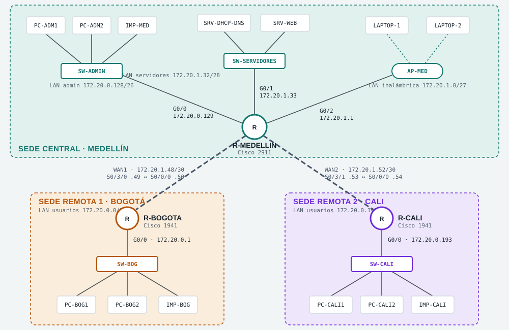

# Café Montaña S.A.S. – Red corporativa multisede

Trabajo final de Redes de Datos I (Politécnico Colombiano Jaime Isaza Cadavid).
Integrantes: Mauricio, Andrés y Edward.



Topología en estrella sobre el bloque `172.20.0.0/23`: Medellín concentra los servicios (DHCP, DNS y web) y se une a Bogotá por WAN1 (`172.20.1.48/30`) y a Cali por WAN2 (`172.20.1.52/30`).

## Contenido

| Archivo | Qué es |
|---|---|
| `index.html` | Diseño de la red: topología, plan VLSM, tablas de direccionamiento, pruebas y preguntas de sustentación |
| `maqueta.html` | Maqueta 3D interactiva de las tres sedes, con modo de realidad aumentada para Android |
| `img/topologia.svg` | Diagrama de la topología (el de arriba) |
| `guias/00-PLAN-GENERAL.md` | Plan del equipo: reparto, reglas, tablas VLSM y de dispositivos, pruebas finales y preguntas de sustentación |
| `guias/01-MAURICIO-SEDE-CENTRAL.md` | Guía paso a paso de la sede central (Medellín) |
| `guias/02-ANDRES-SEDE-BOGOTA.md` | Guía paso a paso de la sede remota 1 (Bogotá) |
| `guias/03-EDWARD-SEDE-CALI.md` | Guía paso a paso de la sede remota 2 (Cali) |

Las dos páginas se enlazan entre sí. No necesitan compilación ni servidor propio: son HTML estático.

## Publicar con GitHub Pages

1. Crea un repositorio en GitHub, por ejemplo `cafe-montana-red`.
2. Sube los archivos de esta carpeta a la raíz del repositorio.
   Desde la terminal, dentro de esta carpeta:
   ```bash
   git init
   git add .
   git commit -m "Diseño y maqueta 3D de la red de Café Montaña"
   git branch -M main
   git remote add origin https://github.com/USUARIO/cafe-montana-red.git
   git push -u origin main
   ```
3. En GitHub, ve a **Settings → Pages**. En **Source** elige **Deploy from a branch**, rama **main** y carpeta **/ (root)**, y guarda.
4. En uno o dos minutos la página queda en:
   - Diseño: `https://USUARIO.github.io/cafe-montana-red/`
   - Maqueta: `https://USUARIO.github.io/cafe-montana-red/maqueta.html`

## Realidad aumentada

- Funciona en **Android con Chrome** y un celular compatible con **ARCore** (Servicios de Google Play para RA).
- La página debe abrirse desde una dirección **https** (GitHub Pages ya lo es). Desde un archivo local o `http` no funciona.
- En iPhone el navegador no ofrece este modo, así que el botón no aparece. La maqueta 3D normal sí funciona.

Cómo usarla:
1. Abre `maqueta.html` en el celular y toca **Ver en realidad aumentada**.
2. Acepta el permiso de la cámara.
3. Mueve el celular apuntando al piso o a una mesa hasta que aparezca un anillo verde.
4. Toca la pantalla para colocar la maqueta (mide unos 65 cm de ancho).
5. Toca un equipo para ver su ficha. **Mover maqueta** la vuelve a colocar y **Salir de AR** regresa a la vista normal.

## Requisitos

Las páginas cargan desde internet las fuentes (Google Fonts) y el motor 3D (Three.js 0.128 desde jsDelivr), así que necesitan conexión.
